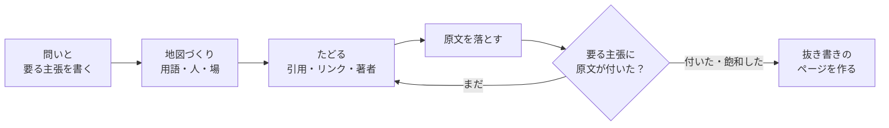

# imozuru

<picture>
  <source media="(prefers-color-scheme: dark)" srcset="assets/brand/logo/imozuru-lockup-light.svg">
  
</picture>

知らない分野を、言葉を知らないところから原文にたどりつくまで掘る Codex のスキル。

Codex に調査を頼むとき、検索結果の要約だけでなく、根拠となる原文を手元で読みたい人のためのスキル。
人の情報探索の研究（Bates の berrypicking、Ellis の探索行動のモデル、Kuhlthau の探索過程）を参考に、原典へたどりつく探索を支援する。
界隈の用語・中心の人・場を先に特定し、引用・リンク・著者を芋づる式にたどって、当たりの原文をそのまま手元に落とす。

## 何をするか



- **地図を作る**: 違う探し方の2本（英語と日本語など）で、用語・人・場・定番の資料を集めて `map.md` に書く
- **たどる**: 参考文献を後ろへ、被引用を前へ、著者で追う、場を通しで見る。論文の分野でも、個人のブログや動画しかない分野でも同じ動きでたどる
- **原文を落とす**: PDF・記事・YouTube の字幕を `sources/` に保存する。404 やログインの壁は中身を見て弾く
- **原文を渡す**: 既定では要約を作らず、主張ごとに「どのファイルの何行目か」を指す。判断するのは原文を読む人
- **証拠で止める**: 最初に「答えるのに要る主張」を決め、その全部に原文が付くか、新しい資料がほとんど出なくなったら止める
- **抜き書きのページ**: 原文からそのまま切り出した文を主張ごとに並べた HTML を作る。抜き書きが原文の指定の行にそのまま在るかを機械で照合し、照合に失敗したら原文・引用・行番号を確認して修正する
- **見張る**: 掘って見つけた場所（Qiita・Zenn のタグ、note、YouTube、ブログ、arXiv）の新着を RSS で引き、原文の冒頭1行つきで並べる

## Codex への導入

このリポジトリを取得し、`skills/imozuru/` を Codex のスキルディレクトリへコピーする。macOS / Linux で、リポジトリのルートから実行する例:

```sh
mkdir -p ~/.agents/skills
cp -R -i skills/imozuru ~/.agents/skills/
```

プロジェクトだけで使う場合は、上のコマンドの代わりに、対象プロジェクトの `.agents/skills/imozuru/` に配置する。このリポジトリ内だけで使うなら、ルートから次を実行する。

```sh
mkdir -p .agents/skills
cp -R -i skills/imozuru .agents/skills/
```

ユーザー用とプロジェクト用のどちらかを選び、同名スキルの重複インストールは避ける。更新時は保存先の独自変更を確認してから置き換える。以前の環境に入れたスキルは自動では移動されない。

Codex で `$imozuru` を指定するか、下の例のように依頼する。CLI / IDE では `/skills` で確認できる。表示されなければ Codex を再起動する。詳しくは [公式のスキル仕様](https://learn.chatgpt.com/docs/build-skills)。

このリポジトリの `skills/` は配布用の置き場であり、それだけではプロジェクト用スキルとして自動検出されない。

## 要るもの

Web 検索とローカルコマンドの実行が利用できる Codex 環境で使う。原文の取得にはネットワーク接続、成果物の保存には書き込み可能な作業フォルダが必要。特定のモデルやサブエージェントは必須ではない。

スクリプトは Python 3.10 以上の標準ライブラリだけで動く。次のコマンドは、あれば使う。

| コマンド | 使うところ | 無いとき |
|---|---|---|
| `pdftotext`（poppler か Xpdf） | PDF を文字にする | PDF の本文が取れず `FAIL` になる |
| `pdftoppm`（poppler か Xpdf）と `tesseract` | 文字の層が無い古い PDF の OCR | その PDF は `FAIL` になる |
| `yt-dlp` | YouTube の字幕を落とす | 動画は `FAIL` になる |
| [ax](https://github.com/yusukebe/ax) | HTML を markdown にする | 標準ライブラリで文字にする（見出しや表の形は ax のほうが残る） |

引用をたどる `chain.py` は [OpenAlex](https://openalex.org/) の API を使う。スクリプトは API キーを送らない。認証やレート制限で使えない場合は、本文の参考文献と Web 検索でたどる。

## 使い方

Codex の会話に、スキル名と調べたい内容を書く。`$imozuru` はシェルコマンドではなく、Codex に渡す指定。

```text
$imozuru 歌ってみたの MIX で、上手い人がどういう順番で処理しているか、本人の記事や動画を芋づる式に探して。
```

明示的な指定がなくても、原典探索の依頼に合えば Codex がスキルを選ぶ。

```text
Gaussian Splatting ってよく聞くけど全然わからない。論文とか解説の流れを掘ってほしい
```

新着確認だけを頼む場合:

```text
$imozuru watch react
```

保存先や調査の上限も指定できる。

```text
$imozuru Gaussian Splatting の編集手法の原典を探して。
./research/gaussian-editing に保存し、2周を上限に、照合済みの抜き書きページまで作って。
```

既存調査を続ける場合は、そのフォルダを指定する。

```text
$imozuru ./research/gaussian-editing の map.md と log.md から、未達の主張の調査を続けて。
```

結果は既定で作業フォルダ内の `research/<話題>/` に置かれる。保存先を指定した場合や既存調査を続ける場合は、その場所を使う。従来の `~/research/<話題>/` も明示して継続できる。

```
map.md         問い・要る主張・用語・人・場・原文の表・次の手がかり
log.md         周ごとに、何を探して何が出たか・判断とその理由
sources/       落とした原文
extracts.json  抜き書き
report.html    抜き書きのページ
```

最初に案内される `report.html` をブラウザで開くと、主張ごとの抜き書きと原文の前後を読める。新着確認では `watch/<日付-時刻>.md` に一覧ができ、`watch.tsv` と `watch-state.json` に監視先と既読情報が残る。新着確認だけでは抜き書きページは作らない。

抜き書きのページの見本は [examples/demo/report.html](examples/demo/report.html) にある。リポジトリのルートで次を実行すると、同梱の原文からページを再生成できる（Web 検索や Codex の起動は不要）。

```sh
python3 skills/imozuru/scripts/report.py examples/demo
```

## 設計の考え方

### 原文と要約を区別する

調べ始めの混乱した段階で詳しくまとめると、早すぎる閉じ（premature closure）を招く（Kuhlthau 1991）。
既定では Codex が原文を保存して場所を示し、判断は原文を読む人がする。要約・解説も依頼された場合は、原文の抜き書きと区別して添える。

### 止めどきを証拠で決める

最初に「答えるのに要る主張」を3〜6個決め、その全部に原文の場所が付いたら止める（HALT・Roh & Han 2026）。
主張は甘く作れてしまうので、少なくとも1つは依頼の言葉の条件をそのまま入れ、半分以上は原文を読まないと答えられない形にする。

もう一つの止めどきは飽和。
同じ問いを異なる2つの探し方（英語と日本語など）で調べ、挙がった人・資料の7割以上が既知で、新しい用語もほとんど出なければ止める。違う仮説同士の結果や空振りでは、飽和を判定しない。
独立した2回の探索の重なりから全体の数を見積もる考え方（Kastner 2007）を借りた。
7割は試しながら決めた目安で、網羅性を保証する値ではない。

既定の探索上限は4周。指定された時間・回数の上限やアクセスの壁でも探索を終え、未達の主張と理由を残す。探索を終えた後、原文と抜き書きの照合、HTML の生成、成果物の案内まで行う。

### 方向を決め打ちしない

AI の検索は、方向がいくつもありうる段階で1つを選び、その後の検索が同じ道を強めて失敗する（Zhou ら 2026 HypoSearch）。
迷ったら別の仮説を探索して比べる。サブエージェントは利用可能かつ許可された場合の選択肢で、単独でも動く。

### 論文の無い分野は個人の発信をたどる

塗り方や MIX のように論文がほとんど無い分野の知恵は、個人のブログや動画にある。
論文の参考文献をたどるのと同じ動きで、記事の中のリンクや「〇〇さんの記事を参考に」をたどる。
落とした原文には種類の印を付け、どれを信じるかは読む人に任せる。

- 〔論文〕査読や会議を通ったもの、arXiv のプレプリント
- 〔本人〕やった本人の記録（自分で試した・作った・測った過程が書いてある）
- 〔観察〕他人の作品ややり方を見て、特徴を書き出したもの
- 〔まとめ〕他人の知見を集めた・言い換えた記事
- 〔公式〕道具や製品を作った側の文書

### 抜き書きを機械で照合する

原文を何十本も落としただけでは読まれない。
間を取るのが Ellis の動きの一つである抜き書き（extracting）。
`report.py` は抜き書きの文が原文の指定の行にそのまま在るかを照合し、1語でも言い換えが混ざっていればページを作らずに止まる。

## 決まりの出典

探索手法の出典と過去の試行記録は [theory.md](skills/imozuru/references/theory.md) にまとめた。過去の環境での観察は、Codex での動作保証とは区別している。

## 気をつけること

- Web を検索すると、問いの中身が検索語として外に出る。機密や個人データが絡む調べものには使わない
- 有料の論文を回避する手段は使わない。取れないものは「届かなかった」と報告する
- 落とした原文は手元で読むための写し。再配布しない

## Codex 向けの構成

[GPT-6 Astra のスキル・プロンプト見直しの記事](https://developers.openai.com/blog/rethinking-skills-and-prompts-for-gpt-6-astra)を参考に、起動条件を絞り、必要な資料だけ段階的に読む構成にした。

- `skills/imozuru/SKILL.md`: 目的・モードの選択・成果物の条件。
- `skills/imozuru/references/`: 調査、新着確認、抜き書き、地図の書式、道具、理論。必要なモードだけ読む。
- `skills/imozuru/agents/openai.yaml`: Codex の表示名・呼び出し例。
- `AGENTS.md`: このリポジトリを保守するための情報。調査手順は常時読み込ませない。

Codex では `$imozuru` で呼び出す。スキルの説明は原典探索と新着確認に絞り、特定モデルや並列起動を前提にしない。原文・抜き書きの照合は Python スクリプトが担い、既存の保存データも引き続き使える。

## 開発時の確認

```sh
python3 -m unittest discover -s tests -v
python3 skills/imozuru/scripts/report.py examples/demo --check
```

テストは一時ファイル・モック・ローカル HTTP サーバーを使い、外部サービスへ接続しない。実際の検索品質や外部サービスの取得可否は別途確認が必要。

## ライセンス

MIT
